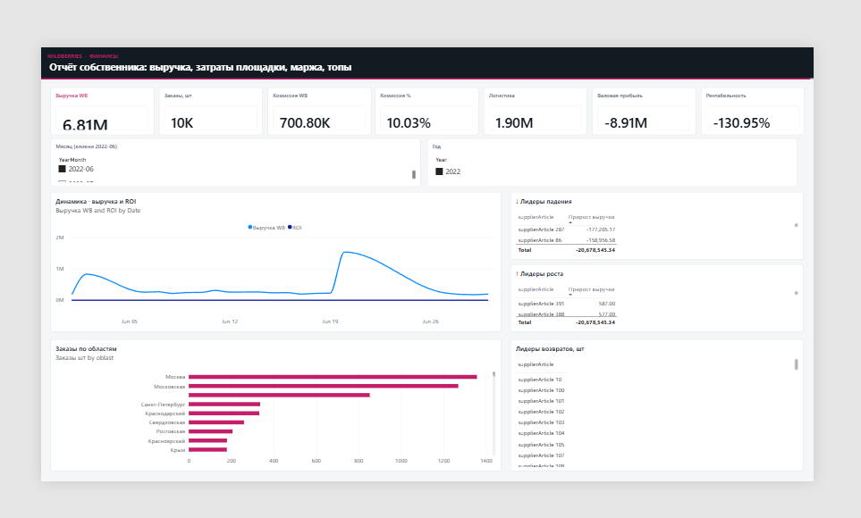
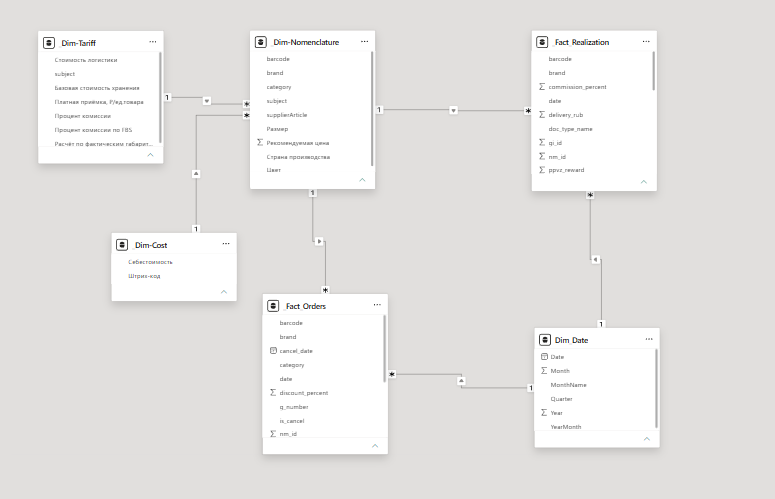

# Marketplace finance dashboard (Power BI)

Star / snowflake semantic model for **Wildberries-style seller finance**: facts from **PostgreSQL** (Import only), dictionaries from a public spreadsheet via `Excel.Workbook(Web.Contents(...))` — not the Google Sheets connector, not DirectQuery.

**Author:** [David-saytrue](https://github.com/David-saytrue) · Tbilisi, Georgia

Related: [power-bi-sales-dashboard](https://github.com/David-saytrue/power-bi-sales-dashboard) · [leetcode-sql50-](https://github.com/David-saytrue/leetcode-sql50-)

---

## Dashboard

Owner-facing finance page: KPI cards, month/year filters, revenue & ROI trend, decline/growth leaders by SKU, orders by region, return leaders.

---

## Data model

| Layer | Tables | Source |
|-------|--------|--------|
| Facts | `_Fact_Realization`, `_Fact_Orders` | PostgreSQL views (Import) |
| Dimensions | `_Dim-Nomenclature`, `_Dim-Cost`, `_Dim-Tariff`, `Dim_Date` | Sheet tabs + DAX calendar |
| Staging | `_Workbook` | xlsx export URL — **Enable load OFF** |

Relationships: **one-to-many**, dimension → fact (or dim → dim in the snowflake), **Single** cross-filter only (**0 bidirectional ↔**).

Keys:

- `Dim_Nomenclature[barcode]` → facts `[barcode]`
- `Dim_Cost[Штрих-код]` → `Dim_Nomenclature[barcode]`
- `Dim_Tariff[subject]` → `Dim_Nomenclature[subject]`
- `Dim_Date[Date]` → fact date columns

---

## Power Query (M)

| File | Query name |
|------|------------|
| `queries/00-Workbook.m` | `_Workbook` |
| `queries/Dim-Nomenclature.m` | `Dim_Nomenclature` |
| `queries/Dim-Cost.m` | `Dim_Cost` |
| `queries/Dim-Tariff.m` | `Dim_Tariff` |

Paste into **Advanced Editor**. Barcodes are normalized to text (Excel often loads them as numbers with `.0`).

Postgres: connect in Desktop with your own credentials; load realization + orders; rename to the fact table names above.

---

## DAX measures

KPIs aligned with the assignment metrics: WB revenue, orders, commission & %, logistics, COGS, gross profit, profitability, ROI, prior-month revenue, MoM change, returns.

See [`dax-measures.dax`](dax-measures.dax).

Hardest parts: gross profit stack (fees + 2% + cost from the cost dim) and period comparison with `DATEADD`.

---

## Rebuild checklist

1. Paste M queries → Close & Apply.
2. Import Postgres facts.
3. Create `Dim_Date` and relationships as in the diagram.
4. Add measures from `dax-measures.dax`.
5. Build the report page (or open your local `.pbix`).

The working `.pbix` is kept private (credentials / sandbox data). This repo has rebuild scripts + screenshots only.

---

## Portfolio note

Interview-style case: multi-source ingest, dimensional modeling, and business metrics on large realization volumes (~600k rows). DB host and passwords are **not** in this repository.
